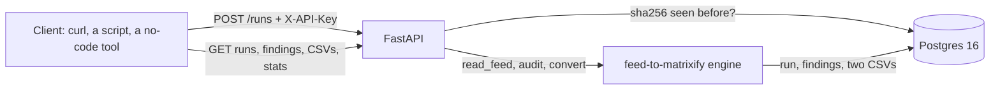

# feed-audit-api

Upload a supplier's product feed (CSV) and get back a Shopify import, ready for
[Matrixify](https://matrixify.app), plus an audit of everything wrong with the feed.
Every run, every finding and both output files are kept in Postgres, so "what did
this supplier send us last Tuesday, and what was wrong with it" is one request away.

The feed logic is not in this repository. It is
[feed-to-matrixify](https://github.com/dkautomation23/feed-to-matrixify), a
standard-library engine with its own tests; this service installs it as a package
pinned to a commit and wraps it in an HTTP API, a database and a container. The
API's CSV downloads are byte-for-byte what the engine's CLI writes, and a test
holds that.



## Run it

```bash
cp .env.example .env
docker compose up --build --wait
```

Postgres comes up on port 5435, the API on 8000, both bound to `127.0.0.1`
only: the demo password and key in `.env.example` are public. Alembic migrates the schema
before the server takes traffic, and the API container only starts once the
database reports healthy. Interactive docs are at http://localhost:8000/docs.

## Use it

Upload the synthetic sample feed (a German-style export: semicolons, decimal
commas, twenty rows carrying the defects real feeds carry):

```bash
curl -s -H "X-API-Key: demo-key-change-me" -F "file=@sample/supplier-feed.csv" http://localhost:8000/runs
```

The numbers in the answer are the ones the engine's CLI prints for the same file:

<!-- sample:start -->
```json
{
  "rows_read": 20,
  "products": 15,
  "variants": 7,
  "rows_left_out": 1,
  "findings_total": 11,
  "findings_blocking": 1,
  "delimiter": ";",
  "encoding": "utf-8-sig",
  "decimal": ","
}
```
<!-- sample:end -->

Upload the same file again and the answer is `200` with the first run and
`"already_seen": true` instead of `201` and a duplicate.

```bash
# what blocked a row from the import
curl -s -H "X-API-Key: demo-key-change-me" "http://localhost:8000/runs/1/findings?level=blocker"
# the Shopify import and the audit report, as files
curl -s -H "X-API-Key: demo-key-change-me" -o matrixify-import.csv http://localhost:8000/runs/1/matrixify.csv
curl -s -H "X-API-Key: demo-key-change-me" -o audit-report.csv http://localhost:8000/runs/1/report.csv
# the problems suppliers send most often, over every run
curl -s -H "X-API-Key: demo-key-change-me" "http://localhost:8000/stats/findings?limit=5"
```

## Endpoints

| Method | Path | What it does |
| --- | --- | --- |
| GET | `/health` | `200` when the API can query Postgres, `503` when it cannot. No key. |
| POST | `/runs` | Upload a feed (multipart `file`). `201` new run, `200` same file seen before, `413` over `MAX_UPLOAD_BYTES` (5 MB by default), `422` `FeedUnreadable` when the engine cannot read it. |
| GET | `/runs` | Runs in id order, cursor-paginated: `?after=<id>&limit=<1..100>`, `next_cursor` is `null` on the last page. |
| GET | `/runs/{id}` | One run's summary. |
| GET | `/runs/{id}/findings` | Its findings, filterable by `?level=` (`blocker`, `warning`) and `?what=`. |
| GET | `/runs/{id}/matrixify.csv` | The Matrixify import, exactly as the engine CLI writes it. |
| GET | `/runs/{id}/report.csv` | The audit report, exactly as the engine CLI writes it. |
| GET | `/stats/findings` | Findings grouped by what and level across all runs, most frequent first. |

Everything except `/health`, `/docs` and `/openapi.json` needs the `X-API-Key`
header; a missing or wrong key is `401`. The key is compared with
`hmac.compare_digest`, so the time a wrong key takes to reject does not leak how
much of it was right.

An upload is turned away before its body is read. FastAPI parses the whole
multipart body before any dependency runs, so a check in the endpoint alone
would come after a 200 MB file had been received. A small ASGI middleware
answers `401` for a missing or wrong key and `413` for a `Content-Length` over
the limit without reading the body, and cuts off a body sent without a length
as soon as it passes the limit.

## Design choices

- **Synchronous SQLAlchemy.** Each request is one short transaction and the
  heavy part, the engine, is CPU-bound Python that async would not speed up.
  FastAPI runs sync endpoints in its thread pool, so a slow upload does not
  block the others. Async would add a second driver and a second way to write
  every query for no measured gain here.
- **Idempotency by the file's sha256**, enforced by a `UNIQUE` constraint, not
  only by a lookup: two uploads of the same file at the same moment both pass
  the lookup, and the loser gets the winner's run back instead of a 500.
- **The output CSVs are stored as text** in `run_files`, so a download a month
  later is the same bytes the engine produced, even after the engine changes.
- **Schema by Alembic migrations**, never `create_all`; the test suite builds
  its database with the same migration, and `alembic check` in CI confirms
  the models and the migration agree.

## Tests and numbers

All numbers below are printed by a command; none is typed by hand.
`python check.py` reruns the tests and coverage and compares them with this
page. The load numbers are a saved measurement: `check.py` confirms this page
matches `docs/load-check.txt`, and `python scripts/load_check.py` remeasures.

- **53 pytest tests**, all on a real Postgres (a throwaway `feedaudit_test`
  database, built by the Alembic migration), none on SQLite. They include the
  cases that should fail: an unreadable feed, an empty file, a binary file, a
  file one byte over the limit, no key and a wrong key on every protected route,
  the same file twice, a lost upload race, and paging through every page
  returning every run exactly once.
- Line coverage of `app/`: **99%** (`pytest --cov=app`).
- Single-thread load check, `python scripts/load_check.py`: 200 synthetic feeds
  from `scripts/make_feeds.py` (four export formats, fixed seed, byte-identical
  on every run), uploaded one after another, then their findings read back. The
  app runs in-process (TestClient) against the Postgres container, on a laptop:

<!-- load:start -->
```text
feeds uploaded: 200, findings stored: 3233
POST /runs: p50 55.9 ms, p95 89.8 ms
GET /runs/{id}/findings: p50 5.7 ms, p95 7.9 ms
```
<!-- load:end -->

```bash
python -m venv .venv && .venv/bin/pip install -r requirements-dev.txt
docker compose up -d db --wait
.venv/bin/python -m pytest --cov=app
.venv/bin/python check.py
```

CI (`.github/workflows/ci.yml`) runs ruff, the migrations and `alembic
check`, the tests against a Postgres service with an 85% coverage floor, the image build, and `docker compose up
--wait` followed by a request to `/health`. Every action is pinned to a commit
SHA.

## What broke while building it

- **A lost upload race returned 500.** Two uploads of the same file both pass
  the "seen this sha256?" lookup; the second insert then hits `UNIQUE(sha256)`.
  The `try` caught `IntegrityError` around `commit()`, but SQLAlchemy raises it
  at `flush()`, which ran before the `try`. The test that forces the race
  failed with the raw `IntegrityError`; the flush moved inside the `try`.
- **Line endings would have changed the input.** Git on Windows with
  `core.autocrlf` warned it would rewrite LF as CRLF in the working copy. That
  changes the sample feed's bytes, so its sha256 and every byte-for-byte
  comparison, and breaks shell lines inside the Linux image. `.gitattributes`
  now keeps LF and marks `*.csv` as data that is never normalised.
- **The release gate failed on itself.** `check.py` looks for Cyrillic text with
  a `\u0400-\u04ff` range, and the tool that wrote the file turned those escapes
  into the literal characters. Its own hygiene check and the privacy scanner
  both flagged `check.py`. The two lines are now generated with the escapes
  kept as escapes, and the gate passes on a file it can read.

Found by two independent reviews before publishing, each fixed with a test
that fails without the fix:

- **The size limit came after the upload.** The endpoint read at most 5 MB of
  the file, but FastAPI had already spooled the whole multipart body, even for
  a request with no key. A 200 MB upload without a key was refused only after
  it had been received in full. The middleware above now refuses it first.
- **An id above 2,147,483,647 was a 500.** Postgres `INTEGER` overflowed inside
  the query. Path ids and the paging cursor are now bounded, so it is a `422`.
- **Two products could merge into one.** The engine grouped rows by Shopify
  handle, and SKUs `A/B` and `A-B` both make `a-b`: the second product became a
  variant of the first and lost its title with no finding. The engine now
  groups by SKU, suffixes the clashing handle and reports the clash. A field
  over Python's CSV size limit also crashed the reader; it is a `422` now.

## Honest limits

- **The engine commit this pins is not on GitHub yet.** Until it is pushed,
  `pip install -r requirements.txt` and a Docker build without `.env` cannot
  fetch it, and CI will fail at install. Locally, install the engine from a
  checkout (`pip install -e ../feed-to-matrixify`) and set
  `ENGINE_CONTEXT=../feed-to-matrixify` in `.env` for the image build.
- An accepted upload is read into memory; that is why there is a 5 MB limit,
  enforced before the body is received. A multi-hundred-megabyte feed would
  need streaming the engine does not do.
- The demo key and database password are defaults for a local run. Exposing
  the stack beyond `localhost` means setting both in `.env` first.
- Idempotency is by exact bytes. The same feed re-saved with different line
  endings or a different column order is a new run.
- One shared API key, no users, no rate limiting, no way to delete a run.
- The load numbers are one thread on one machine with the app in-process. They
  say a single upload of a typical feed takes tens of milliseconds; they are
  not a throughput claim.
- Output CSVs live in Postgres. At thousands of large feeds a day they belong
  in object storage with only the metadata in the database.

## License

MIT
